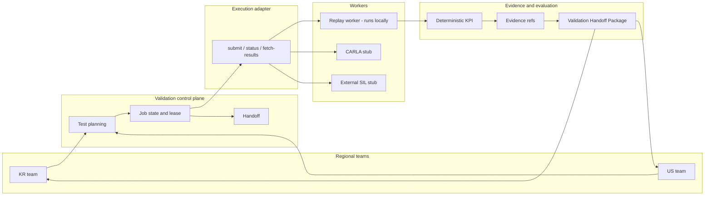
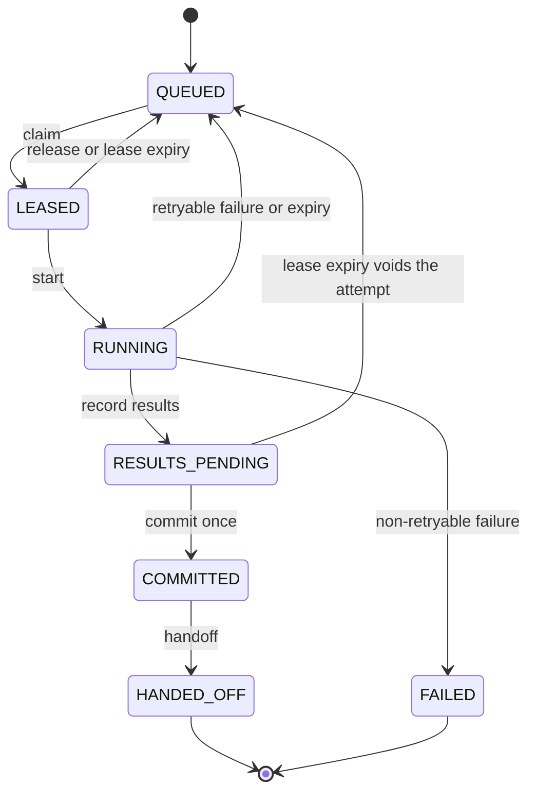

# 42dot Follow-the-Sun SIL Validation Platform

> **수업 프로젝트 제안의 로컬 PoC입니다.** 성능 수치는 없습니다. 42dot의 실제 로그, 모델, 내부 절차, 측정된 지연을 담고 있지 않습니다. 아키텍처와 지표는 제안이며, 구현·성능이 확인된 결과가 아닙니다.

한 지역 팀이 발견한 자율주행 모델의 실패를, 다른 지역 팀이 **추가 설명 없이** 재현하고, 원인 가설을 유지한 채, 다음 검증 단계로 넘길 수 있는가?

This repository is a course scaffold for that question. Korea finds a failure, seals a Validation Handoff Package, and the US side reruns it from that JSON alone. The runnable path is a deterministic local replay worker. CARLA and external SIL adapters are stubs. The Terraform under `infra/` is a proposal sketch and is not deployed.

## English summary

42dot's Korean and US teams already have SIL simulation. This project does not replace that simulator. It proposes an AWS control plane that carries a failure from one site to the other: model checkpoint hashes, scenario and dataset version, seed, simulator version, container digest, safety profile and KPI rule version, the observed regression, log refs, a root-cause hypothesis with an uncalibrated confidence, the next tests, and job owner / state / lease / attempt id.

End states are **Confirmed**, **No Material Regression**, **Inconclusive**, and **Not Evaluated**. Inconclusive must include follow-up tasks. A duplicate submit or an SQS redelivery must not commit a second result. The optional question-score / Ridge / logistic module can suggest review order and must not change the safety verdict.

The rainy-night intersection below is a **hypothetical** scene used to make the handoff concrete. It is not a 42dot incident.

## 문제

한국과 미국 팀은 시차가 있어, 한 팀이 실패를 찾은 뒤 다른 팀이 같은 실험을 잇기까지 맥락이 빠질 수 있습니다. 모델, 시나리오, 시드, 시뮬레이터, 컨테이너, 판정 규칙이 문장으로만 전달되면 받는 팀은 그것을 다시 물어봐야 합니다. 같은 작업을 두 번 내거나, 워커가 죽은 뒤 재시도하거나, 오래된 결과가 늦은 쓰기로 최신 결과를 덮으면 어떤 실행이 확정본인지 알 수 없습니다. 실행이 끝났다고 검증이 끝난 것은 아닙니다.

이 저장소가 다루는 범위는 다섯 가지입니다.

1. SIL 실행과 결과 수집 (로컬에서는 replay, CARLA/외부 SIL은 인터페이스만)
2. 재현에 필요한 근거를 패키지로 고정
3. 작업 상태와 소유권
4. 시간대를 넘기는 후속 작업 인계
5. 제3자가 패키지만으로 돌리는 재현 검사

범위 밖: 시뮬레이터 자체를 새로 만드는 일, dSPACE 등 상용 SIL 대체, 실차 데이터 학습.

## 가상 시나리오: 비 오는 야간 교차로 보행자 (KR → US)

**이 시나리오는 인계를 설명하기 위한 가상 사례입니다.** 실제 사고, 실제 로그, 실제 42dot 모델이 아닙니다. 장면 파라미터와 모델 거동은 패키지 안의 synthetic model card입니다. 신경망 가중치는 없습니다.

| 단계 | 누가 | 무슨 일이 일어나는가 |
| --- | --- | --- |
| 1. 발견 | 한국 | 같은 시드·시나리오에서 모델 A(베이스라인)와 B(후보)를 실행한다. B는 가림이 풀린 뒤 제동이 늦어 충돌하고 차선을 벗어난다. A는 그렇지 않다. |
| 2. 정리 | 제어 평면 | 결정론적 KPI를 계산하고, 환경과 로그 해시를 패키지에 고정한다. |
| 3. 가설 | 한국 | 원인 가설을 적는다. 예: 가림 이후 인지·제동 지연. 확신도는 보정되지 않은 분석가 라벨이고, 갈라지지 않은 항목은 `unconfirmed`에 남긴다. |
| 4. 배정 | 제어 평면 | 후속 시험(동일 조건 재현, 보행자 속도 1.6 m/s 변형)을 작업으로 등록하고 소유권을 넘긴다. 판정은 **Inconclusive**이며 후속 과제가 패키지 안에 있다. |
| 5. 인수 | 미국 | 패키지 JSON만 입력으로 같은 실행을 재현하고, 패키지에 적힌 변형 시험을 돌린다. |
| 6. 회신 | 한국 다음 주기 | 재현 fingerprint가 같고 변형 시험도 같은 규칙에서 material regression이면 판정은 **Confirmed**다. 이것은 회귀가 재현되었다는 뜻이지, 원인 가설이 증명되었다는 뜻이 아니다. |

`Confirmed`의 정의는 실험을 보기 전에 `src/fts/verdict.py`에 적혀 있습니다. 결과를 보고 기준을 바꾸지 않습니다.

## 시스템이 질문에 답하는 방식

재현에 필요한 것은 패키지 필드뿐입니다. 시나리오 카탈로그(`src/fts/scenarios/`)는 한국이 **처음** 실행을 만들 때만 씁니다. 미국 경로(`src/fts/receive.py`)와 제3자 검사(`src/fts/reproduce.py`)는 그 모듈을 가져오지 않습니다.

| 질문의 한 조각 | 패키지 / 제어 평면이 하는 일 |
| --- | --- |
| 추가 설명 없이 재현 | 모델 카드 해시, 시나리오 파라미터와 그 해시, 시드, 시뮬레이터 버전, 컨테이너 다이제스트, KPI 규칙 버전. replay 워커는 이 값이 자기 구현과 다르면 실행을 거절한다. |
| 원인 가설을 유지 | `root_cause.statement`, 보정되지 않았다고 못 박은 `confidence`, `unconfirmed` 목록. 판정이 Confirmed여도 가설은 미확정으로 남는다. |
| 다음 검증으로 넘김 | `recommended_next_tests`는 시드와 파라미터 override를 포함해 그 파일만으로 실행된다. Inconclusive는 후속 과제가 비어 있으면 스키마가 거절한다. |
| 결과를 두 번 확정하지 않음 | Job 상태 기계, lease/heartbeat, `version` 조건부 쓰기, 멱등 키. `commit_count`는 0에서 1로 한 번만 올라간다. |

## 아키텍처





로컬 실행 경로는 replay 워커입니다. CARLA와 외부 SIL은 같은 `submit / status / fetch-results` 인터페이스를 구현하지만 로그를 만들어내지 않고 **Not Evaluated**만 반환합니다. 점 질량 운동학은 차량 동역학이나 CARLA가 아닙니다.

## AWS 서비스 매핑

아래는 제안된 제어 평면입니다. 이 저장소의 실행 가능한 대응물이 오른쪽에 있습니다. `infra/terraform/`은 스케치이며 배포하지 않습니다.

| 역할 | AWS | 이 PoC |
| --- | --- | --- |
| 상태 흐름 | Step Functions | `src/fts/jobs/control.py` 상태 기계. ASL 초안은 `infra/terraform/statemachine.asl.json` |
| 작업 전달 | SQS | 스케치. 최소 한 번 전달이므로 소비자는 멱등 키가 필요하다 |
| 조건부 상태, lease, 재시도 기록 | DynamoDB | `DynamoShape` 인터페이스와 메모리/파일 백엔드. AWS 자격 증명은 읽지 않는다 |
| 로그, 패키지, 불변 산출물 | S3 | 로컬 JSON과 `repo://` URI, 내용 해시 |
| Worker | ECS 또는 Batch | 로컬 replay. ECS desired count 0, Batch 큐 DISABLED로 스케치만 |
| 지표 | CloudWatch | 수식만 정의. 알람 리소스는 스케치 |
| 권한 | IAM | 제어 평면 / 워커 / 읽기 전용 감사 역할 스케치 |

SQS는 같은 메시지를 두 번 줄 수 있습니다. 확정은 `commit_count == 0`인 조건부 쓰기와 멱등 키로 한 번만 일어납니다. 같은 키의 재전송은 이미 확정된 작업을 돌려주고, 다른 키는 `AlreadyCommitted`로 거절합니다. 만료된 attempt의 결과는 커밋되지 않습니다.

## 지표와 수식

비교 대상은 세 가지로 제안되어 있습니다. **Baseline A**는 수동 파일·메시지 인계, **Baseline B**는 공유 저장만, **Proposed**는 패키지 + 상태 제어 + 인계입니다. 실험은 아직 없습니다. 아래 수식을 만족하는 측정값은 이 저장소에 없습니다. `src/fts/metrics.py`는 수식만 계산하고, 비용 항이 하나라도 비어 있으면 비용을 만들지 않습니다.

- 재현 성공률 = 목표 조건 재실행 성공 수 / 총 재현 시도 수
- 중복 결과 확정률 = 동일 논리 Job의 중복 확정 결과 수 / 전체 확정 결과 수
- 인계 완료 시간 = 다음 팀의 첫 유효 실행 시작 시각 − 이전 팀의 패키지 확정 시각
- 작업 누락률 = 미등록·미승계 후속 작업 수 / 전체 인계 대상 작업 수
- 운영 비용 = Worker 계산 + 스토리지 + 데이터 이동 + 관리 서비스
- 회귀 검증 완료 시간 = 사전 정의 판정 상태 확정 시각 − 실패 발견 시각

데모가 터미널에 찍는 거리나 fingerprint는 이 가상 장면을 다시 돌린 출력입니다. 성공률이나 지연의 측정값이 아닙니다.

## 패키지

스키마 버전은 `fts.handoff.v1`입니다. 모델은 `src/fts/domain/package.py`, JSON Schema는 `schema/handoff.package.v1.schema.json`입니다.

내용 해시는 `content_hash` 필드를 뺀 정규화 JSON의 SHA-256입니다. 키 순서는 해시에 영향을 주지 않습니다. 예시 패키지:

- `examples/handoff/kr_discovery.json` — 한국 발견. 판정 Inconclusive. 후속 과제 두 개.
- `examples/handoff/us_return.json` — 미국이 재현과 변형 시험을 기록하고 Confirmed로 회신. `parent_content_hash`로 한국 패키지를 가리킨다.

KPI 규칙 버전 `kpi-rules-2026.11-draft`의 material regression은 다음 중 하나입니다. 기준선 A에는 없고 후보 B에 있는 충돌, 마찬가지로 새로 생긴 차선 이탈, 최소 거리가 규칙의 안전 거리보다 짧으면서 0.5 m를 초과해 줄어든 경우. 차선 폭은 시나리오 기하이며 로그에 들어 있습니다. 충돌 거리는 점 질량 근사 0.75 m입니다. 차량 다각형이 아닙니다.

## 구현 단계

| 단계 | 제안 | 이 저장소 |
| --- | --- | --- |
| 1. Worker PoC | CARLA에서 A/B 비교와 로그 | replay 워커가 결정론적으로 동작. CARLA는 스텁 |
| 2. Handoff package | 스키마, 해시, 제3자 재현 | 스키마, 봉인, 예시, `fts repro` |
| 3. 분산 제어 | 중복 요청, 재시도, 소유권 | 로컬 상태 기계와 DynamoDB 형태 인터페이스. 중복 확정 0은 테스트로 잠근 불변 조건이지, 운영에서 측정한 비율이 아니다 |
| 4. KR/US 운영 모의 | 시차 인계와 누락 측정 | `fts demo` 한 건의 스크립트. 누락률을 측정하지 않았다 |
| 5. 평가 확장 | 수동/자동 인계 비교, Laya/Jev | 선택 모듈만. 이름과 질문 수는 미확정. 안전 판정을 바꾸지 않는다 |

## 저장소 지도

```
src/fts/domain/        패키지 스키마와 해시
src/fts/jobs/          상태, lease, 멱등 키, 메모리/파일 저장
src/fts/adapters/      replay, CARLA 스텁, 외부 SIL 스텁
src/fts/kpi/           결정론적 평가
src/fts/scenarios/     한국 최초 실행용 카탈로그. 수신 경로는 사용하지 않음
src/fts/receive.py     미국 팀. 입력은 패키지 JSON
src/fts/reproduce.py   제3자 재현 검사
src/fts/extension/     선택적 검토 우선순위
src/fts/metrics.py     지표 수식
examples/handoff/      봉인된 예시 패키지
infra/terraform/       배포하지 않는 IaC 스케치
docs/ai_evaluation_extension.md
```

## 실행

한 줄로 데모를 돌립니다. 가상환경을 만들고 패키지를 설치한 뒤, 한국 발견부터 미국 회신까지 실행하고 방금 쓴 패키지를 다시 검사합니다.

```bash
bash scripts/demo.sh
```

이미 설치되어 있다면:

```bash
python -m fts demo
python -m fts repro examples/handoff/kr_discovery.json
python -m fts repro examples/handoff/us_return.json
pytest
```

`fts demo`는 `var/demo/`에 패키지를 씁니다. 커밋된 예시는 같은 각본을 `repo://examples` URI로 봉인한 것입니다. URI가 다르면 content hash도 다릅니다. fingerprint 일치는 둘 다에서 확인합니다.

Python 3.11 이상. 의존성은 `pyproject.toml`에 고정되어 있습니다.

## 미확인 사항

다음을 이 저장소의 사실처럼 적지 않습니다.

- 42dot 내부 인계 절차
- 사용 중인 SIL 공급업체
- dSPACE 연동 권한과 API
- 실제 지역 간 지연 수치
- Laya / Jev 또는 그 밖의 안전 평가 모델의 성능
- 다중 질문의 개수와 문항 (제안서는 예를 들어 25개를 언급합니다. 이 PoC의 문항은 8개이며 예시입니다)
- 운영 비용과 세 baseline의 비교 수치

상용 SIL 연결은 API와 라이선스에 따라 달라집니다. 외부 어댑터는 그 확인 전에는 호출하지 않습니다.

출처로 삼은 팀 초안: 「cloud수업 update내용(10.31)」, 「자율주행 AI SIL 검증 오케스트레이션 기획 정리」, 「10 23 feedback」. 그 초안의 문제 설정은 검증된 고객 사실이 아니라 제안용 가설입니다.
